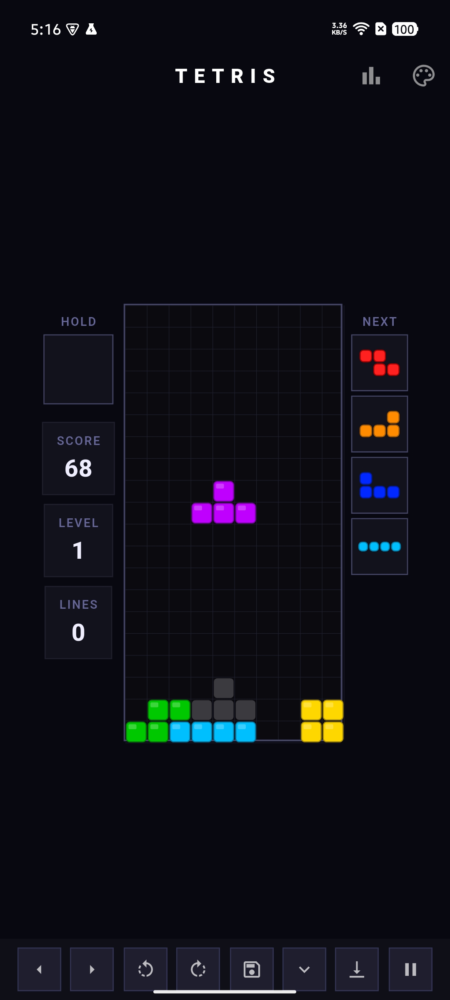

# tetris_engine

[](https://pub.dev/packages/tetris_engine)
[](https://github.com/rojanparajuli/Tetris-Engine/actions/workflows/ci.yml)
[](LICENSE)

A complete, reusable Tetris engine for Flutter. It has no backend and no
dependencies beyond Flutter, and runs on Android, iOS, Web, Windows, Linux and
macOS.



## Features

- **Tetris Guideline rules**: 7-bag randomizer, SRS rotation with wall kicks,
  hold, ghost piece, next queue and lock delay with move reset
- **Scoring**: singles to Tetrises, T-Spins (full and mini), back-to-back,
  combos, perfect clears, soft and hard drop points
- **Game modes**: Endless, Marathon (150 lines), Sprint (40 lines against the
  clock) and Ultra (2-minute score attack), or your own line goal and time
  limit, with best times and scores per mode
- **Levels and gravity**: configurable start level, lines per level and
  gravity curve
- **Widgets**: board renderer, next and hold previews, score, level and lines
  panels, game-mode clock, statistics panel, pause and game-over overlays, on-screen control pad
- **Input**: keyboard with remappable keys (desktop/web), swipe gestures and
  auto-repeating touch buttons (mobile)
- **Events stream** for sound effects, haptics and animations
- **Themes**: light, dark and colorblind-safe themes, all customizable, plus
  per-level color palettes that change as the player levels up
- **Seeded games and exact replays**: record a game as JSON and play it back
  move for move
- **Save and restore**: serialize the full game state to any storage
- **Statistics**: games, scores, lines, levels, play time and piece usage

## Installation

```yaml
dependencies:
  tetris_engine: ^1.4.0
```

## Quick start

```dart
import 'package:tetris_engine/tetris_engine.dart';

final game = TetrisGame()..start();

// In your widget tree:
TetrisBoard(
  game: game,
  theme: darkTetrisTheme,
  onGameOver: () => print('Game over! Score: ${game.state.scoreState.score}'),
)
```

Remember to call `game.dispose()` when you're done with it.

## Layout example

```dart
Column(
  children: [
    Expanded(
      child: Row(
        children: [
          Column(
            children: [
              HoldPiecePreview(game: game),
              ScorePanel(game: game),
              LevelPanel(game: game),
              LinesClearedPanel(game: game),
            ],
          ),
          SizedBox(width: 200, child: TetrisBoard(game: game)),
          NextPiecePreview(game: game, count: 4),
        ],
      ),
    ),
    TetrisControlPad(game: game), // on-screen buttons for touch devices
  ],
)
```

## Game options

```dart
TetrisGame(
  boardRows: 20,
  boardCols: 10,
  nextQueueSize: 5,
  startLevel: 1,
  linesPerLevel: 10,
  lockDelay: const Duration(milliseconds: 500), // Duration.zero = classic
  maxLockResets: 15,
  gravityCurve: (level) => Duration(milliseconds: 800 ~/ level),
  seed: 42,                // same seed → same pieces (e.g. daily challenge)
  mode: TetrisGameMode.sprint, // see Game modes below
  statistics: myStats,     // share lifetime stats between games
)
```

## Game modes

| Mode | Ends when | Result |
| --- | --- | --- |
| `TetrisGameMode.endless` (default) | the stack tops out | score |
| `TetrisGameMode.marathon` | 150 lines are cleared | score |
| `TetrisGameMode.sprint` | 40 lines are cleared | time |
| `TetrisGameMode.ultra` | 2 minutes of play time pass | score |

```dart
final game = TetrisGame(mode: TetrisGameMode.sprint)..start();

// Switch mode for the next game.
game.start(mode: TetrisGameMode.ultra);

// Or define your own.
const sprint20 = TetrisGameMode(name: 'Sprint 20', lineGoal: 20);
```

Topping out still ends any mode. Every ending sets `status` to
`TetrisGameStatus.gameOver`, so `onGameOver` fires for all of them, and
`state.endReason` says how the game ended:

```dart
switch (game.state.endReason) {
  case GameEndReason.goalReached: showResult('Cleared in ${game.playTime}');
  case GameEndReason.timeUp:      showResult('Time! ${game.state.scoreState.score}');
  case GameEndReason.toppedOut:   showResult('Game over');
  case null:                      break; // still playing
}
```

The `gameOver` event carries the same `endReason`. While playing,
`game.linesRemaining` and `game.timeRemaining` report goal progress (null when
the mode has no such goal), and `GameModePanel` shows them as a clock and a
lines-left counter. `TetrisStatistics` keeps the best time and best score for
each mode: `statistics.bestTime(TetrisGameMode.sprint)`.

## Sound effects, haptics and animations

Every action is reported on `game.events`:

```dart
game.events.listen((event) {
  switch (event.type) {
    case TetrisEventType.hardDropped:
      HapticFeedback.mediumImpact();
    case TetrisEventType.linesCleared:
      if (event.tSpin != TSpinType.none) playSound('tspin');
      else if (event.lines == 4) playSound('tetris');
      else playSound('clear');
      if (event.perfectClear) showBanner('PERFECT CLEAR');
    case TetrisEventType.levelUp:
      showBanner('Level ${event.level}');
    default:
      break;
  }
});
```

The simple callbacks `onScoreChanged`, `onLevelUp`, `onLinesCleared` and
`onGameOver` are still available.

## Themes

```dart
// Built-in themes
TetrisBoard(game: game, theme: defaultTetrisTheme);    // light
TetrisBoard(game: game, theme: darkTetrisTheme);       // dark
TetrisBoard(game: game, theme: colorblindTetrisTheme); // Wong palette

// Custom theme
final myTheme = darkTetrisTheme.copyWith(
  boardBackground: Colors.black,
  tetrominoColors: TetrominoColors(
    fill: {TetrominoType.I: Colors.cyan, /* ... */},
    border: {TetrominoType.I: Colors.blue, /* ... */},
  ),
);
```

### Level colors

As in classic Tetris, colors can change every level. `LevelThemes` applies a
palette per level on top of a base theme (ten built-in palettes that cycle),
and `LevelThemeBuilder` rebuilds only when the level's theme changes:

```dart
final levelThemes = LevelThemes(base: darkTetrisTheme);

LevelThemeBuilder(
  game: game,
  levelThemes: levelThemes,
  builder: (context, theme, _) => Column(
    children: [
      LevelPanel(game: game, theme: theme),
      Expanded(child: TetrisBoard(game: game, theme: theme)),
    ],
  ),
);

// Change palette every 3 levels, or supply your own palettes
LevelThemes(
  base: darkTetrisTheme,
  levelsPerPalette: 3,
  palettes: [
    LevelPalette.fromFills({for (final t in TetrominoType.values) t: Colors.cyan}),
    LevelPalette.fromFills({for (final t in TetrominoType.values) t: Colors.pink}),
  ],
);
```

With a light base theme only the piece colors change by default; pass
`recolorBoard: true` to also use the palettes' dark board colors.

Levels advance every `linesPerLevel` cleared lines (default 10) and gravity
speeds up with each level.

## Replays

Attach a recorder to the game. It captures every input, gravity step and lock
together with the game's seed, so playback reproduces the game exactly.

```dart
// Record
final recorder = ReplayRecorder();
final game = TetrisGame(recorder: recorder)..start();
// ... play ...
final json = recorder.exportJson();

// Replay onto any game
final saved = ReplayRecorder()..importJson(json);
ReplayPlayer(InputController(replayGame)).play(
  saved.frames,
  seed: saved.seed,
  onComplete: () => print('Replay finished'),
);
```

## Saving state

```dart
// Serialize
prefs.setString('tetris_save', jsonEncode(game.toJson()));

// The save includes the game mode and play time, so a timed game resumes
// with the time it had left.
// Restore (comes back paused, so call resume() to continue)
game.loadFromJson(jsonDecode(prefs.getString('tetris_save')!));
game.resume();
```

## Controls

### Keyboard (desktop and web)

| Key | Action |
|-----|--------|
| ← / A | Move left |
| → / D | Move right |
| ↓ / S | Soft drop |
| ↑ / W / X | Rotate clockwise |
| Z | Rotate counter-clockwise |
| Space | Hard drop |
| C / Left Shift | Hold |
| P / Esc | Pause |

Remap keys with `keyMap`:

```dart
TetrisBoard(
  game: game,
  keyMap: {
    ...TetrisKeyboardHandler.defaultKeyMap,
    LogicalKeyboardKey.keyK: 'hardDrop',
  },
)
```

### Touch

On `TetrisBoard` itself:

- **Tap**: rotate clockwise
- **Swipe left/right**: move
- **Swipe down**: soft drop
- **Fast swipe down**: hard drop
- **Long press**: hold

`TetrisControlPad` adds on-screen buttons. Holding move or soft drop repeats
the action (tune it with `repeatDelay` and `repeatInterval`).

`TetrisBoard` pauses the game automatically when the app goes to the
background. Set `pauseOnBackground: false` to turn this off.

## Custom game loops

Turn off the internal timers to step the game yourself, for example from a
fixed-step loop, an AI or a test:

```dart
final game = TetrisGame()..useInternalClock = false;
game.start();
game.applyGravity();      // one gravity step
game.lockActivePiece();   // lock if the piece is resting on the stack
game.expireTimeLimit();   // end a timed mode when your clock runs out
```

## Architecture

```
TetrisGame (ChangeNotifier, events stream)
├── CollisionSystem    — collision and ghost piece
├── RotationSystem     — SRS wall kicks, T-Spin detection
├── BoardManager       — lock and line clear
├── PieceManager       — seeded 7-bag randomizer
├── ScoringSystem      — Guideline scoring
└── LevelSystem        — progression

Widgets
├── TetrisBoard        — CustomPainter renderer + keyboard/gesture input
├── TetrisControlPad   — on-screen buttons
├── NextPiecePreview / HoldPiecePreview
├── ScorePanel / LevelPanel / LinesClearedPanel / StatisticsPanel
└── TetrisPauseOverlay / TetrisGameOverOverlay
```

## Contributing

Bug reports and pull requests are welcome. See
[CONTRIBUTING.md](https://github.com/rojanparajuli/Tetris-Engine/blob/master/CONTRIBUTING.md).

## License

MIT
